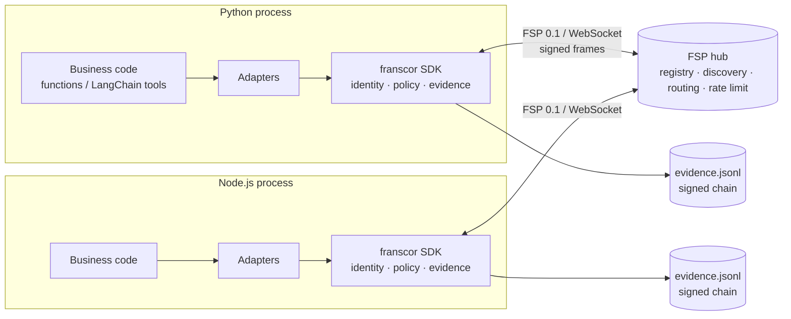
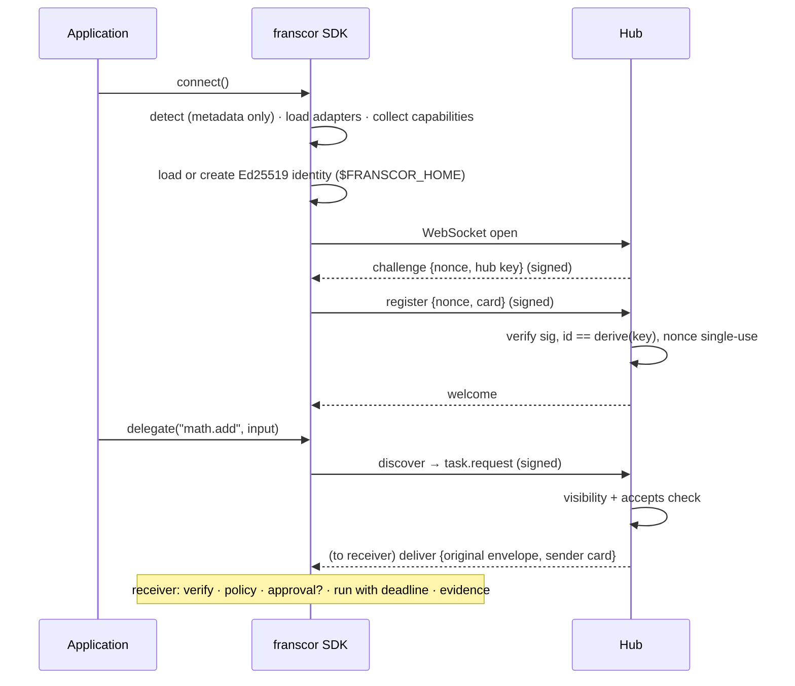

# FRANSCOR — Architecture blueprint

Status as of 2026-11-16: milestones **M1 (foundation)**, **M2 (hardening)**, **M3 (federated control plane, first stage)** and **M4 (bridges)** done locally.
Every "implemented" line below has tests; every "planned" line has none yet.

## 1. Repository audit (what was inspected, what was reused)

| InterMesh component (repo root) | Verdict | Use in FRANSCOR |
|---|---|---|
| `sdk-python/intermesh/canonical.py` — sorted-key JSON, float rejection | **Reused** | Basis of `franscor.canonical`; extended with RFC 8785 number formatting. Float-free records stay byte-identical. |
| `sdk-python/intermesh/assurance/evidence.py` — Action Evidence v0.1 (Ed25519, SHA-256, `prev_hash` chain) | **Reused as the format** | FRANSCOR writes exactly this record. Proven by a test: `intermesh.assurance.evidence.verify_chain` validates evidence written by **both** FRANSCOR SDKs. |
| `assurance/risk.py` — R0…R5 scale, "reversible, by whom" | **Reused** | Capability risk levels; R4+ requires human approval by default. |
| `assurance/policy.py` — first-match rules, mandatory default | Concept reused | Receiver-side `AgentPolicy` (default deny). HTTP rule matching stays in the InterMesh proxy for now. |
| `assurance/proxy.py` — HTTP egress interception | **Kept, not merged** | Remains the way to intercept *outbound HTTP* of an agent. FSP covers agent-to-agent. A bridge is planned (M4). |
| `signing.py` — Ed25519 PEM + key fingerprint | **Reused** | Same PEM format and `kid = sha256(pem)[:16]`. |
| `identity.py` — UUID IDs, SHA-256 fingerprint of metadata | **Replaced** | IDs were not bound to a key. FSP IDs are derived from the public key (self-certifying). |
| `crypto.py` — RSA-2048 hybrid E2E encryption | Not reused yet | E2E payload encryption is planned (M3) with X25519 + AES-GCM instead of RSA. |
| `hub.py` (1 672 lines), `agent.py`, `message.py` — `intermesh/v1` JSON over WebSocket, JWT HS256/EdDSA | **Not reused** | Frames were unsigned, timestamps were floats (cross-language hash risk), auth was hub-issued JWT. FSP signs every frame end-to-end. The InterMesh hub keeps running unchanged for existing users. |
| `sdk-js/` — JS client for `intermesh/v1` (`ws` dependency) | Not reused | The new TypeScript SDK is typed, has zero runtime dependencies (Node ≥ 22 built-in WebSocket). |
| `tests/test_cross_language.py` | Pattern reused | Same idea (hub + Node subprocess), now asserting signatures and evidence. |

Nothing was deleted or modified outside `franscor/`. The `intermesh` package and its
documentation remain the reference for the evidence specification
(`specs/action-evidence-v0.md`).

## 2. System view



Trust boundaries:

* **Agent ↔ agent** authenticity does not depend on the hub: the receiver checks the
  original signature and that `agent_id == sha256(public_key)`.
* **Authorization** is enforced by the receiver (`AgentPolicy`). The hub applies the same
  accept/visibility rules as a convenience and to avoid leaking existence.
* **Evidence** is written by the agent that executes, signed with its own key.

## 3. Connect sequence



## 4. Components and decisions

### 4.1 SDKs (implemented, Python and TypeScript, same behavior)

| Module | Python | TypeScript | Notes |
|---|---|---|---|
| Canonical JSON | `canonical.py` | `canonical.ts` | Byte-identical, checked by shared vectors |
| Identity | `identity.py` | `identity.ts` | Ed25519, key files shared between languages, 0600, optional passphrase; parsed keys cached |
| Key stores | `keystore.py`: file, OS keychain (`keyring`) | file | Replaced keys are kept as `<name>.key.rotated-<ms>`, never destroyed |
| Rotation / revocation | `statements.py`, `Agent.rotate_key/revoke_key` | `statements.ts`, `rotateKey/revokeKey` | Statements byte-identical across languages (vectors) |
| Telemetry | `telemetry.py` | `telemetry.ts` | Optional OpenTelemetry; W3C trace context inside the signed request; metadata only. `agent.stats` counters always on |
| Envelope | `envelope.py` | `envelope.ts` | Sign / verify / shape / clock skew 120 s |
| Evidence | `evidence.py` | `evidence.ts` | InterMesh v0.1 records, JSONL chain, resumable |
| Capabilities | `capabilities.py` | `capabilities.ts` | Name, risk, schema; Python passes dict as kwargs, TS passes `(input, ctx)` with an `AbortSignal` |
| Policy | `policy.py` | `policy.ts` | Default: own org, R4+ approval, no handler = refuse |
| Detection | `detect.py` | `detect.ts` | Reads package metadata only; never imports project code |
| Adapters | `adapters/` | `adapters.ts` | `functions`, `langchain` (duck-typed Runnable: tools and compiled LangGraph graphs). Python plugins via entry points at connect time; TS adapters passed explicitly. Python: tested against real `langchain-core` 1.8 (`@tool`) and `langgraph` 1.2 (compiled `StateGraph`). TypeScript: tested against a stand-in only |
| Runtime | `client.py` | `client.ts` | connect, discover, delegate (retries, idempotent), send/on_message, cancel, reconnect with backoff |
| CLI | `franscor hub/detect/identity/verify` | `franscor detect/identity/verify` | Hub ships with the Python package |

**Sync vs async.** Both SDKs are async-first (`await connect()`), which matches every
framework targeted. Python sync handlers run in worker threads so they never block the
loop. For blocking code, `franscor.connect_sync()` returns a `SyncAgent` backed by a
private event-loop thread.

**Automatic bootstrap.** Installation runs no code. "Automatic" means: at `connect()`,
the SDK detects the environment, loads adapters, and registers what they find. Agents
that expose nothing discoverable are registered explicitly with `capability(...)`.

### 4.2 Control plane

**M3 delivered (tested):**

* **End-to-end payload encryption** (Python and TypeScript, byte-identical vectors):
  inputs, outputs and messages are sealed for the recipient with X25519 + HKDF +
  AES-256-GCM; the X25519 key is derived from the agent's Ed25519 seed, so rotation
  rotates both. Hubs only see metadata. Mode `auto` (default) / `required` / `off`.
* **Signed agent cards** (`card_sig`), required by hubs and checked by SDKs: a hub
  cannot swap an encryption key or widen an `accepts` list in a card it relays.
* **Hub federation**: hub-to-hub links over FSP, mutual allow-list of hub IDs,
  sharing of `public` cards (one hop), cross-hub routing with checks repeated on the
  receiving hub, and **revocation gossip** across the whole federation (a stolen key
  is refused everywhere, and its live sessions are cut).
* **Deployment**: `deploy/Dockerfile` (non-root, keys in a volume, healthcheck),
  `deploy/docker-compose.federation.yml` with two federated hubs, `init_federation.py`
  (keys created outside the image) and `smoke.py`. Rehearsed locally with the same
  scripts and flags on two hub processes; **Docker itself has not been run here**
  (not installed) — the `federation-docker` CI job builds and tests it.

**Not delivered, and why:** PostgreSQL, Redis and NATS. None of them is installed on
this machine, so none could be tested, and the current state does not need them yet:
presence is in memory by nature, the only durable hub state (revocations) is a
verifiable JSONL file, and federation links already move frames between hubs. They
become necessary for one *horizontally scaled* hub (shared presence across replicas)
and for an org directory with endorsement keys — the next control-plane stage.

Decision: **modular monolith first.** M1 ships a single-process hub (registry,
discovery, routing, rate limiting) with in-memory state. Splitting it into services
before there is a second deployment would add failure modes without users to justify
them. The module boundaries already match the target services:

| Target service | M1 location | Planned backing |
|---|---|---|
| API gateway / messaging gateway | `hub.py` WebSocket server | Same process, horizontally scaled behind a TCP LB (M3) |
| Agent registry, discovery | `hub.sessions` (in memory) | PostgreSQL (cards, orgs, keys) + Redis (presence) (M3) |
| Cross-hub routing | — | NATS subjects per agent ID (M3); evaluated against Redis Streams |
| Identity service | self-certifying keys, no service needed | Org-level key endorsement + revocation list (M2) |
| Trust / policy engine | receiver `AgentPolicy` + hub accepts check | Org policies pushed from the control plane (M3) |
| Observability | Python `logging` (no payloads) | OpenTelemetry traces with `task_id` as correlation (M2) |

Draft PostgreSQL schema for M3:

```sql
create table orgs        (id text primary key, display_name text, created_at timestamptz default now());
create table agent_keys  (agent_id text primary key, org_id text references orgs, public_key text not null,
                          kid text not null, status text check (status in ('active','rotated','revoked')),
                          endorsed_by text, created_at timestamptz default now(), revoked_at timestamptz);
create table agent_cards (agent_id text primary key references agent_keys, card jsonb not null,
                          visibility text not null, updated_at timestamptz default now());
create index on agent_cards using gin ((card -> 'capabilities'));
create table evidence_index (hash char(64) primary key, agent_id text, org_id text, task_id text,
                             capability text, status text, ts bigint, prev_hash char(64));
```

The evidence *index* stores hashes and metadata only; full records stay with their owner.

### 4.3 Interoperability bridges (M4)

FRANSCOR does not replace MCP or A2A; it bridges them. A bridge is an ordinary FSP agent,
so everything that crosses it is signed, authorized by the target and recorded as evidence.

| Bridge | Direction | Python | TypeScript | Tested against |
|---|---|---|---|---|
| MCP export | FSP capabilities → MCP tools (`franscor bridge mcp`, stdio) | ✅ `bridges.mcp.build_server` | via the Python CLI | `mcp` 2.3 in-process client **and** a real stdio subprocess |
| MCP import | MCP server tools → capabilities `mcp.<server>.<tool>` | ✅ `bridges.mcp.import_tools` (URL, stdio, in-process) | ✅ `importMcpTools(client)` | `mcp` 2.3; `@modelcontextprotocol/sdk` 1.32 |
| A2A export | FSP capabilities → A2A agent (JSON-RPC, agent card, bearer token) | ✅ `bridges.a2a.A2AGateway`, `franscor bridge a2a` | — | `a2a-sdk` 1.3 server stack and client |
| A2A import | A2A skills → capabilities `a2a.<agent>.<skill>` | ✅ `bridges.a2a.import_agent` | — | `a2a-sdk` 1.3 client |
| OpenAI Agents SDK | `FunctionTool` / `Agent.tools` → capabilities | ✅ adapter | planned | `openai-agents` 0.24 |
| AutoGen | `BaseTool` (`FunctionTool`) → capabilities | ✅ adapter | n/a | `autogen-core` 0.7 |
| CrewAI | tools → capabilities | planned | n/a | — |

Mappings and limits:

* **Risk.** MCP `readOnlyHint` ↔ R0–R1, `destructiveHint` ↔ R3+; everything else R2.
  Imported A2A skills default to R2 (A2A cards carry no risk information). Override per
  tool with `risk_overrides`.
* **Identity.** An MCP host or A2A client reaching FSP through a bridge acts with the
  *bridge's* FSP identity: target agents must accept the bridge's org or ID. The A2A
  gateway checks a bearer token (`FRANSCOR_A2A_TOKEN`); A2A card signatures, OAuth and
  push notifications are not implemented.
* **Data.** A2A data parts are protobuf `Value` (all numbers are doubles); bridges restore
  integral values to integers. Streaming (MCP progress, A2A SSE) is not bridged: calls are
  request/response.
* **Exposure.** Export bridges refuse to start without an explicit list (`'*'` is accepted
  for MCP only, and must be typed).

The full loop `FSP → A2A over HTTP → FSP` and `MCP host → stdio → FSP` are covered by tests.

### 4.4 Trust documents (FSP 0.2, RFC-002)

* **Passport (implemented):** hub-signed, short-lived identity document for an agent,
  with a signed CRL per hub, distributed to agents and federated hubs. Carried in every
  `task.request`; receivers verify it (`verify` / `require` modes) and their policy uses
  the hub-attested organization. CLI `franscor passport issue | show | verify | revoke`
  (Python), `show | verify` (Node.js). Spec: `protocol/FSP-0.2.md` §1.
* **Permit (implemented):** with a peering file (`franscor hub --peering FILE`), federated
  traffic is default-deny. The receiving hub verifies the partner agent's passport (partner
  hub key and CRL), issues a permit from the first matching rule — bound to that passport,
  never longer-lived than it — and checks capability, scopes, delegation depth and rate
  before routing. The permit travels in the `deliver` frame; the executing agent verifies it
  against its own hub key and records `execution.permit_id`. Revocation (API, or
  `franscor permit revoke` into the watched file) applies to the next request. CLI
  `franscor permit show | verify | revoke` (Python), `show | verify` (Node.js). Spec:
  `protocol/FSP-0.2.md` §2.
* **Black box (implemented):** with `franscor hub --audit DIR`, every routing decision
  (local, inbound from a peer, outbound to a peer) is appended to an RFC 6962 Merkle log:
  frame, envelope ID, sender, recipient, peer hub, passport and permit IDs, SHA-256 of the
  body (encrypted when E2E is on), decision `allowed` / `blocked` / `masked` /
  `unreachable`, FSP code. The hub signs a checkpoint `{hub_id, tree_size, root, ts}` every
  `--checkpoint-interval`; each federated peer verifies a consistency proof from the size it
  last witnessed, cosigns, and records a conflict (both signed checkpoints) otherwise. At
  start, a hub refuses a log that does not match its own last checkpoint. Export bundles
  (`franscor audit export`) are verified by `franscor audit verify` in Python or Node.js with
  public keys only. Spec: `protocol/FSP-0.2.md` §3.

## 5. Threat model (M1)

| Threat | Mitigation in M1 | Residual risk / next step |
|---|---|---|
| Forged frame from another agent | Every frame signed; receiver checks signature and key-derived ID | — |
| Malicious hub forges a task | Hub cannot sign for an agent; receivers verify the inner envelope | Hub can drop or delay frames (availability) |
| Malicious hub lies in discovery | SDK rejects cards whose ID ≠ key | Hub can hide agents; signed org directories in M3 |
| Replay | Single-use registration nonce; ±120 s window; envelope ID dedupe; idempotent task IDs | Dedupe memory is per process |
| Key theft from disk | 0600 files, optional passphrase encryption, OS keychain (Python) | HSM / cloud KMS; keychain for TypeScript |
| Stolen or compromised key | Self-signed revocation, persisted and re-verified (`--revocations`), gossiped across federated hubs, live sessions cut | Hubs outside the federation do not learn it |
| Key rotation hijack | Rotation must be signed by old **and** new key; hub accepts statements about the sending agent only | Peers' `accept_agents` lists are not updated automatically |
| Unauthorized delegation | Receiver policy (org/agent allowlist), unknown capability rejected, R4+ needs a human | Fine-grained per-capability ACLs (M2) |
| Silent network exposure | Hub binds loopback by default; SDK refuses `ws://` to non-loopback hubs | TLS termination guide (M2) |
| Data leakage via evidence/logs/traces | Hashes only; handler error messages replaced by exception class; spans carry metadata only (tested) | — |
| Payload confidentiality vs hub | E2E encryption of inputs, outputs, messages (M3); cards signed so keys cannot be swapped | Metadata (who, when, which capability, size) stays visible to hubs |
| Self-declared organization or capabilities | Passport: hub attests org, key and capabilities; receivers' policies use the attested org | A compromised hub can attest agents it hosts |
| Forged, replayed, expired or revoked passport | Hub signature, agent binding to `envelope.from`, expiry, signed CRL with ban; tested in both languages | CRL effective once received (bounded by the 24 h lifetime) |
| Partner agent does more than agreed | Permit from the peering file, checked by the receiving hub before routing and again by the executing agent: capabilities, scopes, rate, depth, expiry, revocation; tested in both languages | Depth is reported by the delegating SDKs (honest agents only); scopes are declared by the requester, not inspected in the payload |
| Hub operator rewrites what was routed | Black box: Merkle log, signed checkpoints cosigned by peers with consistency proofs; local edits refused at start; third-party export verification; tested in both languages | Checkpoints prove the past was not rewritten, not that it was written truthfully; history after the last witnessed checkpoint can still be dropped |
| Rogue or compromised peer hub | Mutual allow-list; peer frames signed by hub keys; receiving hub re-verifies agent signatures, revocations, visibility and accepts | A peer can drop or delay traffic, and sees metadata of relayed frames |
| Flooding | Per-session token bucket, 64 KiB frame cap on the hub | Per-org quotas (M3) |
| Agent bypasses FRANSCOR | Out of scope: evidence attests what the SDK saw, not what it did not see | Combine with the InterMesh egress proxy |

## 6. Measured performance

Loopback, one hub, two agents, n = 500, Windows 11 laptop (4 logical CPUs). Scripts:
`benchmarks/bench_python.py` (hub in-process) and `benchmarks/bench_ts.mjs` (Python hub
in a separate process). These numbers describe this machine only; they are not a claim.

| Run | `connect()` | Round-trip p50 / p95 / p99 | Throughput (32 concurrent) | Machine load |
|---|---|---|---|---|
| M1, Python | 84 ms | 6.97 / 8.80 / 9.74 ms | 174 tasks/s | light |
| M2, Python | 141 ms | 12.08 / 14.24 / 15.10 ms | 93 tasks/s | 45–70 % CPU used by other programs |
| M2, TypeScript | 343 ms | 8.59 / 10.51 / 11.53 ms | 108 tasks/s | same; heap 14 MiB |

The M1 and M2 rows were measured under very different background load and are **not**
comparable; a profile of the M2 code showed no new hot spot, and M2 removed two
(public-key re-parsing on every verification, `json.dumps` per string in the canonical
encoder). A delegation still costs 15 Ed25519 operations and one evidence append;
reliable numbers need a benchmark job on a quiet runner.

M3 encryption adds per task two X25519 agreements, two HKDF and two AES-GCM
operations (the agent's derived X25519 key is cached). Three runs with and without
encryption on this machine gave p50 between 10 and 21 ms and 53–69 tasks/s in both
modes: the background load (45–70 % CPU) is larger than the difference, so the
encryption overhead is **not quantified yet**.

## 7. Milestones

| Milestone | Content | Exit criterion | State |
|---|---|---|---|
| **M1** Foundation | FSP 0.1, schemas, vectors, Python + TS cores, hub, functions & LangChain adapters, interop test, CLI | Python ↔ TS acceptance test green | **Done** |
| **M2** Hardening | Key rotation/revocation, OS keychain (Python), OpenTelemetry both languages, `connect_sync`, `agent.stats`, real LangChain/LangGraph tests, TS benchmark, CI workflow (Linux/macOS/Windows × Py 3.11–3.14 × Node 22/24) | All local suites green; **CI not yet run** (workflow committed with the code) | **Done locally** |
| **M3** Control plane (stage 1) | E2E encryption, signed cards, hub federation with revocation gossip, Docker image + compose, CI job | Two federated hubs, cross-org encrypted delegation, revocation across 3 hubs | **Done locally** (Docker untested here). Stage 2 planned: PostgreSQL/Redis/NATS for horizontally scaled hubs, org directory and endorsement keys, org-signed policies |
| **M4** Bridges | MCP export/import, A2A export/import, OpenAI Agents and AutoGen adapters (Python); MCP import (TypeScript) | Tests against the real libraries | **Done locally**. Not done: CrewAI, TS A2A, InterMesh proxy bridge, streaming |
| M5 Distribution | PyPI/npm publishing with trusted publishing + provenance, semver, docs site | Signed releases installable | Planned — **needs your approval to publish** |
